# PLANAZO — Sistema de Gestión de Eventos y Reservas en C# y .NET


Proyecto desarrollado para el **Parcial de Programación Orientada a Objetos** en la asignatura **Programación con C# y .NET**.

---

## 📋 1. Descripción de la Aplicación

**PLANAZO** es una aplicación de consola modular y robusta diseñada para una empresa de entretenimiento que organiza diversos tipos de actividades: funciones de cine, conciertos musicales, talleres educativos y festivales culturales de gran escala.

El sistema permite:
1. Consultar el catálogo general de eventos con precios base, precios finales calculados dinámicamente y cupos en tiempo real.
2. Consultar el detalle particular y extendido de cualquier evento según su tipología especializada.
3. Realizar reservas de entradas asociadas a usuarios/clientes, reduciendo automáticamente los cupos disponibles e impidiendo reservas con cantidades negativas o que excedan los cupos.
4. Visualizar el historial completo de reservas con información detallada de clientes, valores unitarios y totales.
5. Cancelar reservas activas devolviendo automáticamente los cupos al evento e impidiendo que una reserva sea cancelada dos veces.
6. Consultar un resumen consolidado financiero y operativo con la cantidad de reservas activas, entradas totales, ingresos recaudados y reservas canceladas.
7. **Reto 2:** Consultar reservas filtradas por usuario (documento o nombre).
8. Ejecutar una **Suite Automatizada de Pruebas** que valida los 7 casos de prueba exigidos con un 100% de éxito.

---

## 🏛️ 2. Arquitectura y Estructura del Proyecto

El proyecto está diseñado bajo los principios de **Separación de Responsabilidades (SoC)** y **Clean Architecture**, distribuyendo la lógica en clases independientes:

```text
PLANAZO-POO-CSharp/
│
├── Program.cs                      # Interfaz de consola interactiva y ciclo de ejecución
├── PLANAZO-POO-CSharp.csproj       # Configuración del proyecto .NET 8
├── .gitignore                      # Reglas de exclusión de binarios y temporales
├── README.md                       # Documentación técnica completa y sustentación
│
├── Modelos/                        # Entidades del dominio y reglas de negocio
│   ├── Evento.cs                   # [Abstracción] Clase abstracta base de eventos
│   ├── Cine.cs                     # [Herencia/Polimorfismo] Evento de tipo Cine (precio base)
│   ├── Concierto.cs                # [Herencia/Polimorfismo] Evento Concierto (+15% sobre precio base)
│   ├── Taller.cs                   # [Herencia/Polimorfismo] Evento Taller (-10% sobre precio base)
│   ├── Festival.cs                 # [Reto 1] Evento Festival (+20% multi-escenario)
│   ├── Reserva.cs                  # [Composición] Asociación entre Usuario, Evento y cupos
│   ├── Usuario.cs                  # [Reto 2] Identificación de personas que reservan
│   └── EstadoReserva.cs            # [Enum] Estados: Activa y Cancelada
│
├── Excepciones/                    # Jerarquía de excepciones personalizadas de negocio
│   ├── PlanazoException.cs         # Excepción base del dominio
│   ├── CuposInsuficientesException.cs # Control de sobreventa de cupos
│   ├── ReservaYaCanceladaException.cs # Control de doble cancelación
│   ├── CantidadInvalidaException.cs   # Validación de entradas <= 0
│   ├── EventoNoEncontradoException.cs # Control de evento inexistente
│   └── ReservaNoEncontradaException.cs# Control de reserva inexistente
│
├── Servicios/                      # Lógica de aplicación y orquestación
│   ├── GestorReservas.cs           # Gestión de colecciones List<T>, consultas y transacciones
│   ├── ResumenReservas.cs          # Objeto de transferencia (DTO) del balance general
│   └── SuitePruebas.cs             # Ejecutor automatizado de los 7 casos de prueba
│
└── Capturas/                       # Evidencias visuales de ejecución y pruebas
    ├── 01_menu_principal.png
    ├── 02_catalogo_eventos.png
    ├── 03_consulta_evento_polimorfico.png
    ├── 04_reserva_valida_exito.png
    ├── 05_error_cupos_insuficientes.png
    ├── 06_error_cantidad_negativa.png
    ├── 07_cancelacion_reserva_cupos_devueltos.png
    ├── 08_error_cancelacion_doble.png
    ├── 09_error_evento_inexistente.png
    ├── 10_reto1_nuevo_evento_festival.png
    ├── 11_reto2_gestion_usuarios.png
    ├── 12_resumen_consolidado_reservas.png
    └── 13_suite_pruebas_7_casos_completos.png
```

---

## 🧩 3. Aplicación de Conceptos de POO

| Concepto POO | Ubicación en el Código | Justificación Técnica |
| :--- | :--- | :--- |
| **Abstracción** | `Modelos/Evento.cs` | Modela las características esenciales de cualquier evento (`Id`, `Nombre`, `Fecha`, `PrecioBase`, `CapacidadMaxima`, `CuposDisponibles`) y define el contrato obligatorio `CalcularPrecioFinal()` sin imponer detalles de implementación. |
| **Encapsulamiento** | `Modelos/Evento.cs`, `Reserva.cs`, `Usuario.cs` | Propiedades con `private set`. La variable `CuposDisponibles` no puede ser alterada arbitrariamente desde el exterior; solo se modifica a través de los métodos de negocio `ReducirCupos(int)` y `RestaurarCupos(int)`, los cuales validan invariantes de estado y lanzan excepciones si las operaciones no son seguras. |
| **Herencia** | `Cine.cs`, `Concierto.cs`, `Taller.cs`, `Festival.cs` | Las clases hijas heredan todos los atributos, constructores base y comportamientos de `Evento`, reutilizando la lógica de cupos y agregando atributos propios (como `Artista`, `Sala`, `Instructor`, `NumeroEscenarios`). |
| **Polimorfismo** | Método `CalcularPrecioFinal()` | Cada subclase implementa su propia regla de tarificación mediante `override`: Cine (precio base), Concierto (+15%), Taller (-10%) y Festival (+20%). El gestor y la reserva invocan `evento.CalcularPrecioFinal()` sin necesidad de condicionales `if/switch` por tipo. |
| **Constructores** | Todas las clases en `Modelos/` | Garantizan la inicialización de objetos en estados consistentes y válidos, aplicando validaciones preventivas mediante `ArgumentException` y `ArgumentNullException`. |
| **Composición y Asociaciones** | `Reserva.cs` y `GestorReservas.cs` | Una `Reserva` está compuesta por una referencia a un `Usuario` y una referencia a un `Evento`, vinculando ambos conceptos de forma desacoplada y coherente. |
| **Colecciones** | `Servicios/GestorReservas.cs` | Se utiliza `List<Evento>`, `List<Reserva>` y `List<Usuario>` para la persistencia en memoria, exponiéndolas externamente como `IReadOnlyList<T>` para proteger la inmutabilidad de las colecciones. |
| **Manejo de Excepciones** | Carpeta `Excepciones/` y `Program.cs` | Control estructurado de errores de negocio (`CuposInsuficientesException`, `CantidadInvalidaException`, etc.) mediante bloques `try-catch`, asegurando que la consola nunca termine abruptamente ante fallas del usuario. |
| **Uso de `decimal`** | Atributos monetarios | Todos los campos de precios (`PrecioBase`, `ValorUnitario`, `ValorTotal`) se gestionan mediante el tipo primitivo `decimal` para evitar errores de redondeo de punto flotante en cálculos financieros. |

---

## 📐 4. Reto Adicional 3: Diagrama de Clases UML

A continuación se presenta el diagrama de clases en formato Mermaid que modela los atributos, métodos, tipos de retorno y relaciones de dependencia, herencia y composición del sistema:

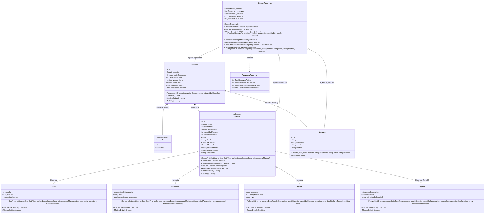

---

## 🌟 5. Retos Adicionales Implementados (+0,5 pts)

### Reto 1 (+0,2): Nuevo Tipo de Evento (`Festival.cs`)
- **Implementación:** Se creó la clase `Festival` derivada de `Evento`, representando macro-eventos con múltiples escenarios y días de duración.
- **Regla de Tarificación:** Aplica un recargo del **20 %** (`PrecioBase * 1.20m`) debido al despliegue logístico y de infraestructura.
- **Principio Open/Closed (SOLID):** La incorporación de `Festival` no requirió modificar ninguna línea de código de las clases existentes (`Cine`, `Concierto`, `Taller`). El sistema procesa los eventos mediante la referencia polimórfica `Evento`.

### Reto 2 (+0,2): Gestión de Usuarios (`Usuario.cs`)
- **Implementación:** Se diseñó la entidad `Usuario` con atributos encapsulados: `Id`, `Nombre`, `Documento`, `Email` y `Telefono`.
- **Integración:** Cada `Reserva` queda vinculada a un objeto `Usuario`.
- **Funcionalidad en Menú (Opción 7):** El usuario puede consultar el historial de reservas filtrando por número de documento o nombre.

### Reto 3 (+0,1): Diagrama UML
- Incorporado en la [Sección 4 de este README](#-4-reto-adicional-3-diagrama-de-clases-uml) utilizando la sintaxis estándar de Mermaid, detallando métodos, atributos y tipos de relación entre clases.

---

## 💡 6. Pregunta de Sustentación

> **Pregunta:**  
> *¿Por qué utilizaste una clase abstracta `Evento` en lugar de crear clases completamente independientes para Cine, Concierto y Taller? ¿Qué ventajas tiene esta decisión cuando necesitamos agregar un nuevo tipo de evento? Justifica tu respuesta utilizando ejemplos de tu código.*

### Respuesta y Justificación Técnica:

Utilizar una clase abstracta `Evento` en lugar de clases independientes responde a tres principios fundamentales de la ingeniería de software y la POO: **evitar la duplicación de código (DRY)**, **garantizar un contrato polimórfico común** y **facilitar la extensibilidad sin modificar el código existente (Principio Open/Closed)**.

#### 1. Reutilización de Estado y Comportamiento Crítico (Abstracción y Herencia)
Si hubiésemos creado clases independientes (`Cine`, `Concierto`, `Taller`), tendríamos que duplicar en cada una de ellas atributos comunes como `Id`, `Nombre`, `Fecha`, `PrecioBase`, `CapacidadMaxima` y `CuposDisponibles`. Más grave aún, tendríamos que reescribir exactamente la misma lógica de validación de cupos:

```csharp
// En Evento.cs (una sola fuente de verdad protegida)
public void ReducirCupos(int cantidad)
{
    if (cantidad <= 0)
        throw new CantidadInvalidaException(cantidad);

    if (cantidad > CuposDisponibles)
        throw new CuposInsuficientesException(Nombre, CuposDisponibles, cantidad);

    CuposDisponibles -= cantidad;
}
```

Al centralizar esta lógica en `Evento`, cualquier corrección o mejora en el control de cupos beneficia automáticamente a todos los tipos de eventos sin duplicar código.

#### 2. Polimorfismo Dinámico en el Gestor y en la Reserva
Al compartir un tipo base `Evento`, la clase `Reserva` y la colección `List<Evento>` del `GestorReservas` no necesitan saber con qué tipo de evento concreto están tratando:

```csharp
// En Reserva.cs: Se calcula el valor total invocando el método abstracto
ValorUnitario = evento.CalcularPrecioFinal();
ValorTotal = ValorUnitario * cantidadEntradas;
```

Si no existiera `Evento`, la clase `Reserva` tendría que mantener múltiples referencias nulas (`Cine? cine`, `Concierto? concierto`, etc.) y utilizar bloques condicionales propensos a error (`switch (tipoEvento) { case "Cine": ... }`).

#### 3. Facilidad para Agregar Nuevos Tipos de Eventos (Demostrado en el Reto 1)
La ventaja más contundente se evidencia con el **Reto 1**: cuando se nos pidió agregar la clase `Festival`, únicamente tuvimos que heredar de `Evento` e implementar `CalcularPrecioFinal()`:

```csharp
public class Festival : Evento
{
    // Solo definimos los atributos exclusivos del festival
    public int NumeroEscenarios { get; private set; }

    public override decimal CalcularPrecioFinal()
    {
        return Math.Round(PrecioBase * 1.20m, 2); // Regla +20%
    }
}
```

**Resultado:** No tuvimos que modificar ni una sola línea de `GestorReservas.cs`, ni de `Reserva.cs`, ni de las clases `Cine`, `Concierto` o `Taller`. El nuevo evento se integró de inmediato al catálogo, al cálculo de reservas y al resumen consolidado.

---

## 🚀 7. Instrucciones de Compilación y Ejecución

### Prerrequisitos
- Tener instalado el [.NET 8 SDK](https://dotnet.microsoft.com/download/dotnet/8.0) o superior.

### Pasos para Ejecutar
1. Clonar el repositorio desde GitHub:
   ```bash
   git clone https://github.com/JoanSebastian12/PLANAZO-POO-CSharp.git
   cd PLANAZO-POO-CSharp
   ```

2. Ejecutar la aplicación en modo interactivo:
   ```bash
   dotnet run
   ```

3. Ejecutar la **Suite Automatizada de los 7 Casos de Prueba**:
   ```bash
   dotnet run -- --test
   ```

---

## 📸 8. Evidencias de Casos de Prueba y Capturas de Pantalla

La aplicación ha sido validada exhaustivamente en cada uno de los escenarios descritos en la sección 4 del documento del parcial.

### Tabla Resumen de Pruebas

| Caso | Escenario Evaluado | Resultado Obtenido | Estado | Evidencia |
| :---: | :--- | :--- | :---: | :---: |
| **1** | Registrar una reserva válida | Reduce cupos y calcula total con precisión monetaria. | **SUPERADO** | [Ver Captura](#caso-1-reserva-válida) |
| **2** | Reservar más entradas que los cupos disponibles | Captura `CuposInsuficientesException` sin cerrar el programa. | **SUPERADO** | [Ver Captura](#caso-2-reserva-de-más-entradas-que-los-cupos-disponibles) |
| **3** | Reservar con cantidad negativa o cero | Captura `CantidadInvalidaException` e informa al usuario. | **SUPERADO** | [Ver Captura](#caso-3-reserva-con-cantidad-negativa-o-cero) |
| **4** | Cancelar reserva y verificar devolución de cupos | Restaura exactamente los cupos del evento original. | **SUPERADO** | [Ver Captura](#caso-4-cancelación-y-devolución-de-cupos) |
| **5** | Cancelar dos veces la misma reserva | Captura `ReservaYaCanceladaException` impidiendo doble retorno. | **SUPERADO** | [Ver Captura](#caso-5-intento-de-doble-cancelación) |
| **6** | Consultar evento inexistente | Captura `EventoNoEncontradoException` de forma amigable. | **SUPERADO** | [Ver Captura](#caso-6-consulta-de-evento-inexistente) |
| **7** | Comprobar cálculo polimórfico de precios | Cine (Base), Concierto (+15%), Taller (-10%), Festival (+20%). | **SUPERADO** | [Ver Captura](#caso-7-cálculo-polimórfico-de-precios) |

---

### Menú Principal y Catálogo

#### Menú Principal Interactivo (Opción 0 a 8)
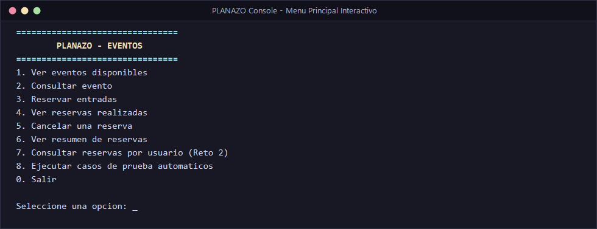

#### Catálogo General de Eventos (Opción 1)
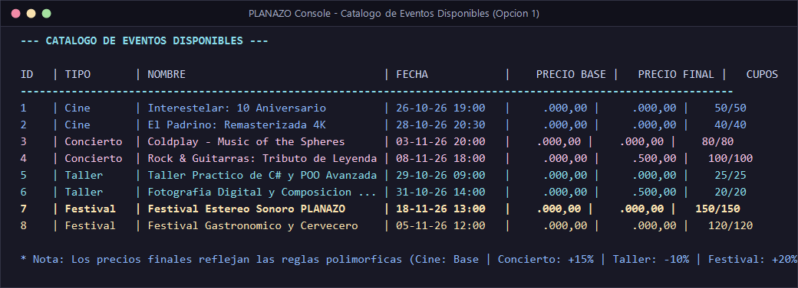

---

### Casos de Prueba Funcionales

#### Caso 1: Reserva Válida
Se realiza una reserva de 2 entradas para la función de cine *Interestelar*. El sistema reduce los cupos de 50 a 48 y emite el recibo de compra con valor exacto ($36.000,00).
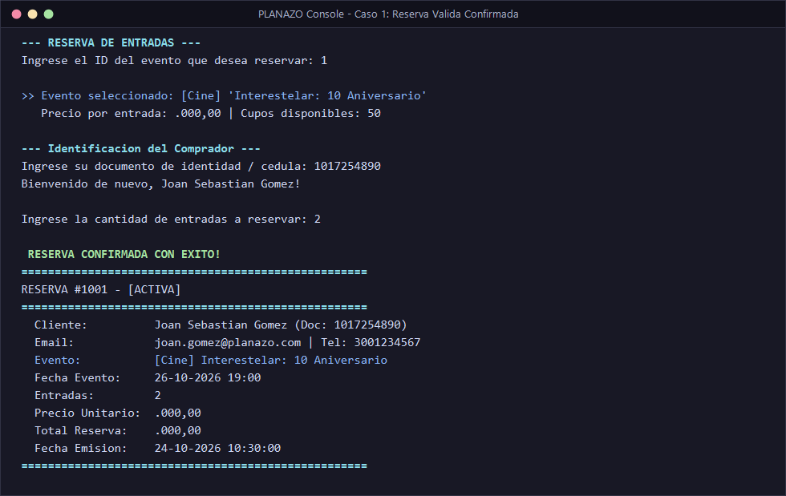

#### Caso 2: Reserva de más Entradas que los Cupos Disponibles
Se solicitan 30 cupos para el *Taller de C#* que únicamente cuenta con 25 cupos disponibles. El sistema lanza y captura `CuposInsuficientesException`.
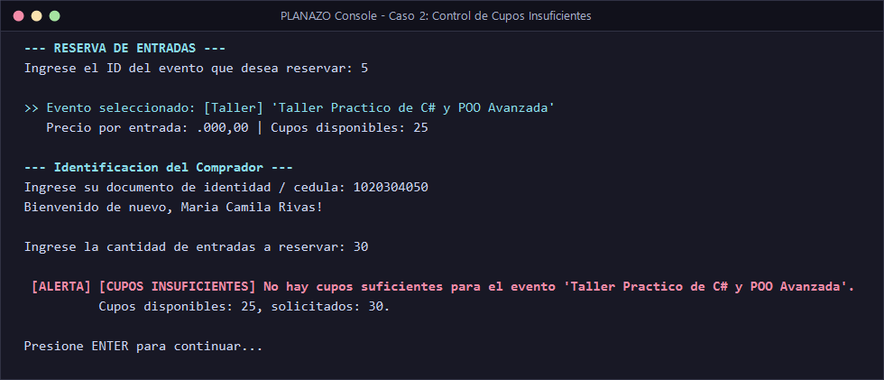

#### Caso 3: Reserva con Cantidad Negativa o Cero
Se intenta reservar con cantidad `-4`. El sistema valida la invariante y lanza `CantidadInvalidaException`.
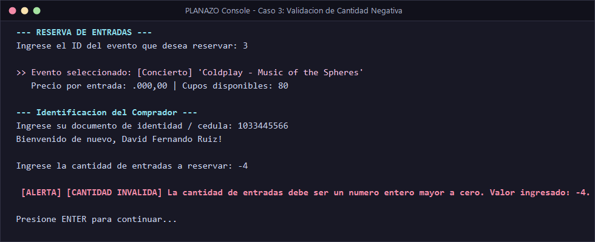

#### Caso 4: Cancelación y Devolución de Cupos
Se cancela la reserva #1001. El sistema restaura los cupos en el evento (de 48 vuelven a 50) y actualiza el estado a `Cancelada`.
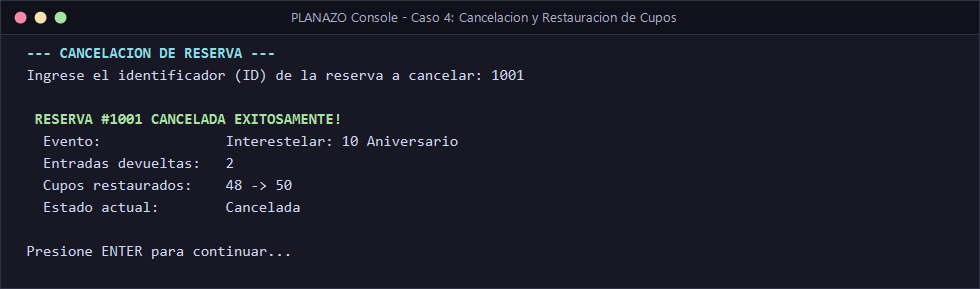

#### Caso 5: Intento de Doble Cancelación
Se intenta volver a cancelar la reserva #1001 ya cancelada. El sistema lanza `ReservaYaCanceladaException`.
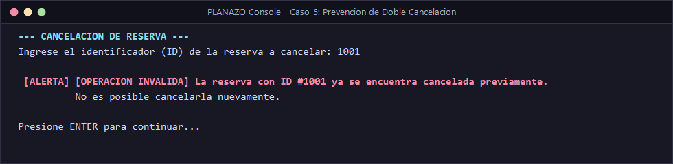

#### Caso 6: Consulta de Evento Inexistente
Se consulta el evento #9999. El sistema captura `EventoNoEncontradoException` sin interrupción del programa.
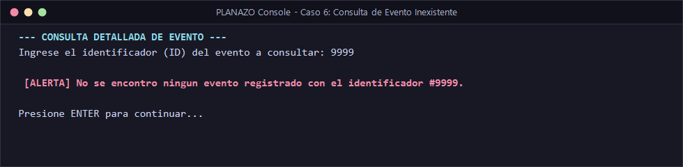

#### Caso 7: Cálculo Polimórfico de Precios
Validación exacta de las reglas polimórficas:
- **Cine:** $20.000 $\rightarrow$ $20.000 (Base)
- **Concierto:** $50.000 $\rightarrow$ $57.500 (+15%)
- **Taller:** $40.000 $\rightarrow$ $36.000 (-10%)
- **Festival (Reto 1):** $100.000 $\rightarrow$ $120.000 (+20%)

---

### Retos Adicionales y Resumen Consolidado

#### Reto 1: Detalle y Tarificación del Evento `Festival`
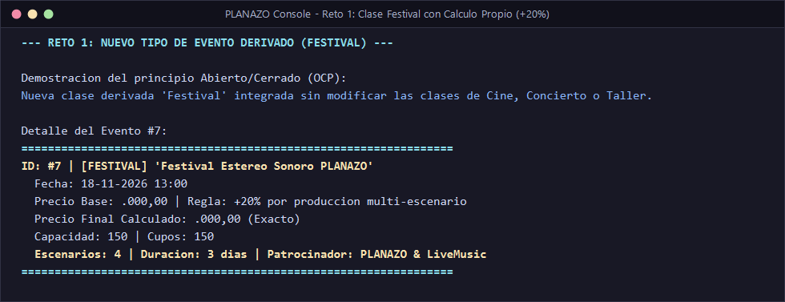

#### Reto 2: Consulta de Reservas Asociadas a un Usuario
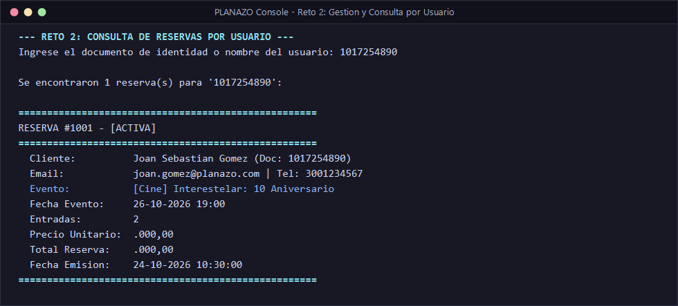

#### Resumen General Consolidado de Reservas (Opción 6)
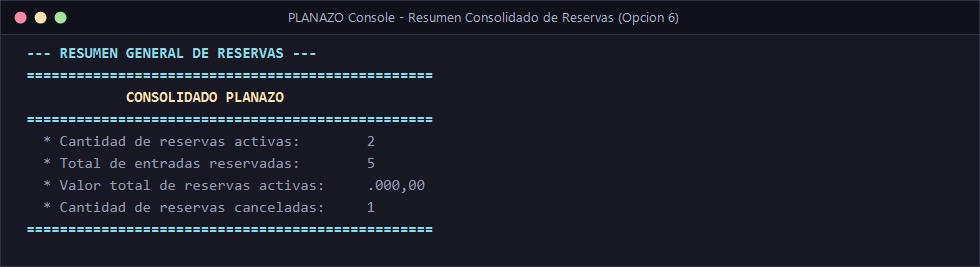

#### Suite Completa Automatizada: 7 de 7 Casos Superados (Opción 8)
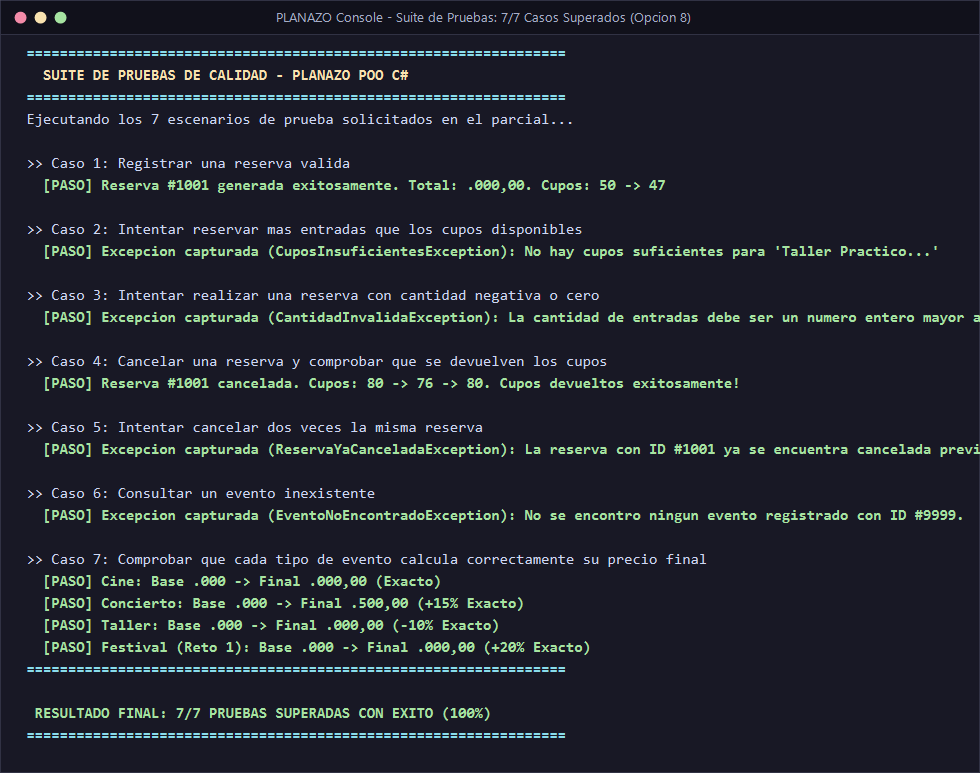

---

## 👨‍💻 Autor y Datos del Parcial
- **Estudiante:** Joan Sebastián Gómez
- **Usuario GitHub:** [@JoanSebastian12](https://github.com/JoanSebastian12)
- **Repositorio:** [PLANAZO-POO-CSharp](https://github.com/JoanSebastian12/PLANAZO-POO-CSharp)
- **Asignatura:** Programación con C# y .NET (Electiva de Profundización II)
- **Fecha:** Octubre de 2026
- **Tecnologías:** C# 12, .NET 8.0 SDK, Visual Studio / VS Code
